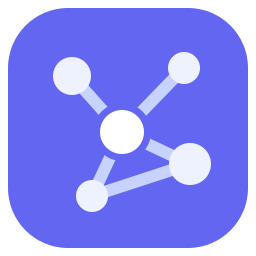
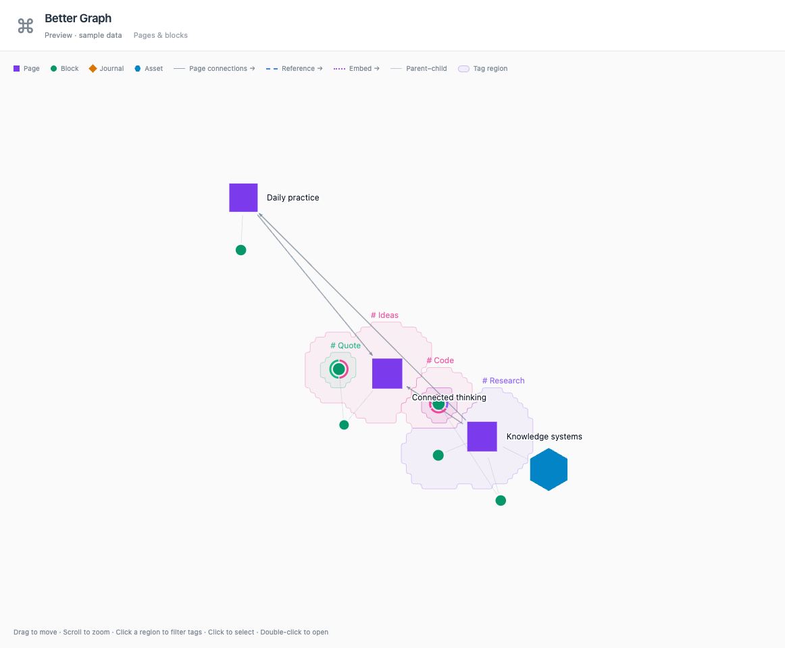

  

# Better Graph

Explore how your Logseq pages, blocks, and tags connect.

  
  
  
  

*Preview with sample data.*

Better Graph is an interactive, read-only graph view for **Logseq DB graphs**. Explore pages and blocks together, with their references, embeds, hierarchy, and shared tags.

## Features

- **See the whole structure.** Page, block, journal, and asset nodes use distinct shapes. Follow page connections, references, embeds, and parent-child links.
- **Explore tag groups.** View your tags separately from Logseq's built-in tags, including Code, Math, and Quote. Toggle tags to filter the graph.
- **Find and inspect nodes.** Search pages and blocks, inspect a node's page, tags, and connections, then open it in Logseq.
- **Tune the view.** Adjust link distance, show journals, drag nodes, and pan or zoom around the graph.

The graph reads your Logseq data without changing pages or blocks. View preferences are saved locally for each graph.
